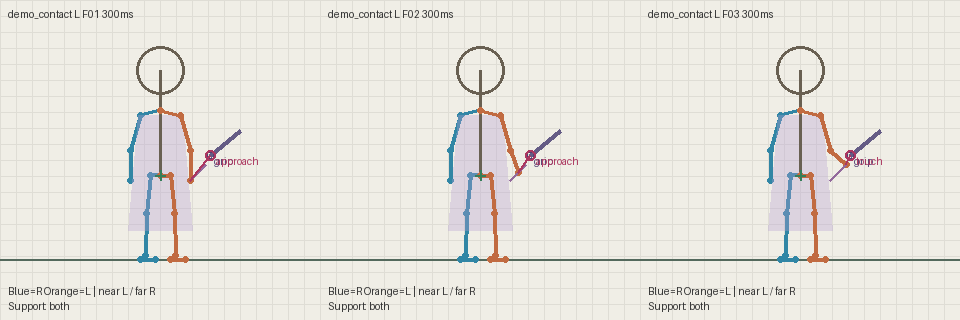

# Sprite & Sprite Sheet Agent

**Diseña el movimiento primero. Dibuja cada fotograma con una referencia verificable.**

[English](README.md) · [简体中文](README.zh-CN.md) · [日本語](README.ja.md) · [한국어](README.ko.md) · [Français](README.fr.md) · [Deutsch](README.de.md) · [Español](README.es.md)

v0.2.0 · **design by santu**

Un flujo de producción y herramientas sin conexión para asistentes de IA con visión. A partir de las vistas del personaje y las acciones solicitadas, organiza estructuras de poses, fotogramas independientes, GIF de revisión y una Sprite Sheet final en PNG con metadatos JSON.

<p align="center"></p>

*Salida real de `scripts/build_demo.py`. Es una demostración técnica anónima, no un personaje terminado ni una animación aprobada.*

## De la pose a la entrega

<p align="center"></p>

1. **Diseñar estructuras** — Confirmar personaje, acciones y accesorios. Definir apoyos, oclusiones y contactos por dirección; después revisar límites de las zonas y paletas.
2. **Revisar fotogramas** — Tras aprobar la estructura, generar poses clave y luego transiciones independientes. Comparar referencias, RAW, candidatos y fotogramas vecinos.
3. **Exportar recursos** — Con la aprobación humana del grupo actual, generar PNG y JSON con rectángulos, pivotes y duraciones. La integración en el motor es una etapa aparte.

| Función | Comportamiento |
| --- | --- |
| Versiones activas | Solo aparecen los grupos del manifest. Los archivos modificados necesitan nuevos hashes; las aprobaciones anteriores quedan obsoletas. |
| Revisión comparativa | Estructura, RAW de IA y candidato en tres columnas; vecinos, tamaño común, fondos y reproducción fotograma a fotograma. |
| Protección de píxeles | El método C restaura regiones inmóviles en las mismas coordenadas y guarda comparaciones e informes de diferencias. |
| Gestión de solicitudes | Paquetes sin conexión con referencias, presupuesto y respuestas. La recuperación consulta el trabajo existente y bloquea su toma duplicada. |
| Atlas sin pérdidas | Exportación PNG + JSON del grupo actual aprobado, con verificación de reconstrucción exacta de cada fotograma. |

**El entorno de IA realiza el diseño del movimiento, el análisis visual y la generación; el usuario aprueba.** No se incluye un servicio de imágenes, aprobación artística automática ni un complemento para motores.

## Inicio rápido

Requiere **Python 3.10+, Pillow y macOS o Linux**. El bloqueo de tareas usa `fcntl`; la ejecución nativa en Windows no está soportada. Ejecuta desde la raíz del paquete:

```bash
python3 -m venv .venv
source .venv/bin/activate
python3 -m pip install Pillow
python3 scripts/build_demo.py ../sprite-agent-demo
```

Abre `../sprite-agent-demo/review/index.html` en el navegador. Verás estructuras, bloques de prueba, un reproductor y controles para exportar opiniones. Los bloques prueban la interfaz; no son personajes generados. La carpeta de salida debe estar vacía: usa una nueva para repetir. No se llama a ninguna API.

## Usar con un asistente de IA

Instala la carpeta completa como `sprite-sheet-agent`, con `SKILL.md` en su raíz. Guarda materiales y resultados en otro espacio de trabajo.

- **Codex:** directorio de skills configurado, por ejemplo `~/.codex/skills/sprite-sheet-agent/`. Recarga e invoca `$sprite-sheet-agent`.
- **Claude Code:** `~/.claude/skills/sprite-sheet-agent/` o el directorio del proyecto. Recarga e invoca `/sprite-sheet-agent`.
- **Otros:** pide que lean [AGENT.md](AGENT.md), [SKILL.md](SKILL.md) y las [reglas de producción](references/production-method.md).

Estas rutas de instalación no se han verificado en sesiones reales. Entregar solo el README no carga todas las reglas. El entorno necesita acceso a archivos y visión; la generación depende de la herramienta o API elegida.

Prepara vistas aprobadas de frente, perfil y espalda, tamaño objetivo y lista de acciones. Añade el perfil opuesto para personajes asimétricos y referencias independientes para accesorios.

> Usa sprite-sheet-agent en mi directorio de personajes. Revisa las vistas y planifica caminar en cuatro direcciones, sentarse y levantarse. Presenta primero las acciones, referencias de accesorios y estructuras de colores. Espera mi aprobación antes de generar fotogramas independientes. Actualiza la página de revisión por grupo y conserva originales, RAW y versiones rechazadas.

## Elegir A / B / C

| Método | Entrada del modelo | Tratamiento |
| --- | --- | --- |
| A | Imagen de referencia + máscara de edición + instrucción breve | Conservar la respuesta para revisión visual. |
| B | Entradas de A + JSON de la tarea actual | Conservar la respuesta para revisión visual. |
| C | Igual que B | Restaurar píxeles con otra máscara de protección y revisar uniones y movimiento. |

Si el proveedor no admite máscaras, registra el modo reducido. JSON expresa restricciones, pero no garantiza su cumplimiento. C requiere regiones inmóviles con las mismas dimensiones y coordenadas. No fijes la posición anterior de la cabeza al sentarse, girar o correr.

Para una misma fuente y respuesta del modelo se permiten como máximo dos composiciones C. La segunda debe cambiar el límite alfa efectivo. No equivalen a dos generaciones adicionales. Confirma por separado presupuesto y llamadas: tres llamadas totales por fotograma son una sugerencia; los límites ya acordados tienen prioridad. Si no hay un candidato válido, deja el fotograma pendiente de corrección.

## Documentación y límites

[Guía en inglés](docs/usage.en.md) · [Guía en chino](docs/usage.zh-CN.md) · [Plantillas](templates/) · [Validación, en chino](VALIDATION.md)

Hay registros de algunas comprobaciones sin conexión. La carga real en asistentes, la calidad de proveedores externos, la producción completa de personajes y la integración en motores siguen pendientes de validación. Este README está en español; las guías están en inglés y chino, y las reglas e interfaz de revisión siguen principalmente en chino.

No se incluye un detector automático de color. El entorno analiza las zonas aprobadas y realiza la revisión visual. Conserva originales y RAW; separa pruebas técnicas, autorrevisión, aprobación humana y validación del motor. Los scripts pueden dibujar guías estructurales, pero no simular movimiento final mediante reflejos, composición de extremidades o interpolación automática.

---

**design by santu**
