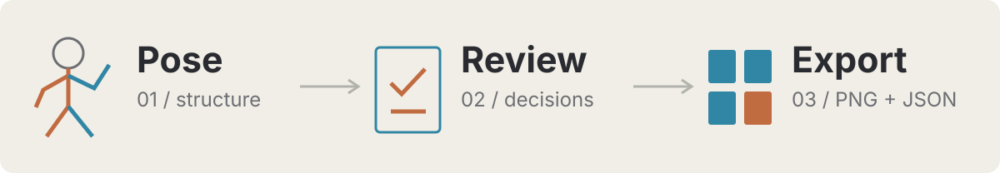

# Sprite & Sprite Sheet Agent

**Design the motion first. Draw each frame with a traceable reference.**

[English](README.md) · [简体中文](README.zh-CN.md) · [日本語](README.ja.md) · [한국어](README.ko.md) · [Français](README.fr.md) · [Deutsch](README.de.md) · [Español](README.es.md)

v0.2.0 · **design by santu**

A character-animation workflow and offline toolkit for AI assistants with vision capabilities. Start with character views and an action brief; organize pose structures, independent character frames, review GIFs, and a final Sprite Sheet PNG with JSON metadata.

[Try the demo](#quick-start) · [Use with an ai assistant](#use-with-an-ai-assistant) · [Usage guide](docs/usage.en.md) · [Validation notes](VALIDATION.md)

<p align="center"></p>

*Actual tool output from `scripts/build_demo.py`. This anonymous structure fixture demonstrates joints, props and contact markers. It does not establish character-art or animation quality.*

## From poses to delivery

<p align="center"></p>

1. **Design poses** — Confirm the character, actions and props. Design each direction's poses, support, occlusion and contacts; then review module boundaries and palettes.
2. **Review frames** — After structure approval, generate key poses followed by independent transition frames. Compare references, RAW results, candidates and neighboring frames, and record corrections.
3. **Export assets** — Once the current character group has human approval, pack an atlas with frame rectangles, pivots, durations and other metadata. Engine integration is a separate step.

### What the tools handle

| Capability | Actual behavior |
| --- | --- |
| Active versions | Review only groups selected by the manifest. Changed files require updated hashes; old review snapshots become stale. |
| Side-by-side review | Structure, AI RAW and selected candidate; neighboring frames, shared display height, backgrounds and frame playback. |
| Pixel protection | Method C restores stationary regions in matching coordinates and writes difference images, comparisons and pixel reports. |
| Bounded requests | Offline packages record references, budgets and receipts. Recovery queries the existing job; repeated claims are blocked. |
| Lossless atlases | Export the currently approved character group as PNG + JSON and verify pixel-exact frame reconstruction. |

**The AI host handles motion design, visual analysis and image generation. The user provides approval.** The package does not include an image service, automatic art approval or an engine plugin.

## Quick start

Try the anonymous demo without an API. Requires **Python 3.10+, Pillow, and macOS or Linux**. Task locking currently uses `fcntl`; native Windows execution is not supported.

Run from the package root:

```bash
python3 -m venv .venv
source .venv/bin/activate
python3 -m pip install Pillow
python3 scripts/build_demo.py ../sprite-agent-demo
```

Open `../sprite-agent-demo/review/index.html` in a browser. It contains pose structures, test tiles, a frame player and review-export controls. The tiles are UI fixtures, not generated characters.

The output directory must be empty; choose a new directory for another run. Demo images, GIFs and the manifest are produced locally without calling an image API.

## Use with an AI assistant

Install the **entire folder** as `sprite-sheet-agent`, keeping `SKILL.md` at its root. Store character assets and run outputs in a separate workspace.

| Host | Entry point |
| --- | --- |
| Codex | Use the configured skill directory, such as `~/.codex/skills/sprite-sheet-agent/`. Reload skills and invoke `$sprite-sheet-agent`. |
| Claude Code | Use `~/.claude/skills/sprite-sheet-agent/` or the project's skill directory. Reload and invoke `/sprite-sheet-agent`. |
| Other assistants | Provide the package and ask the assistant to read [AGENT.md](AGENT.md), [SKILL.md](SKILL.md) and the [production method](references/production-method.md). |

These installation routes have not been verified in live host sessions; they are configuration guidance, not compatibility certification. Supplying only the README does not load the full rules. The host needs file access and vision; image generation comes from your chosen built-in tool or API.

Prepare approved front, side and back views, target dimensions and an action list. Add the opposite side for asymmetric characters, and separate reference assets for props. Start with:

> Use sprite-sheet-agent in my designated character workspace. Check my character views and plan four-direction walking, sitting down and standing up. First deliver the action list, prop references and colored pose structures. Wait for my approval before generating independent character frames. Update the fixed review page after each group, keeping original references, RAW results and failed versions.

## Choosing A / B / C

| Method | Model input | Output handling |
| --- | --- | --- |
| **A** | Reference image + edit mask + short instructions | Keep the model return for visual review. |
| **B** | A's inputs + current-task JSON | Keep the model return for visual review. |
| **C** | Same as B | Restore original pixels using a separate protection mask, then inspect seams and motion. |

If the provider cannot accept a mask, record the degraded workflow. JSON expresses constraints; it does not guarantee that the model obeys every field. C requires confirmed stationary regions on an identical canvas with matching coordinates. Do not lock an old head position during sitting, turning or running.

For one source and one model return, C allows **at most two composites**. The second must change the effective alpha boundary. These are not two additional image-generation calls. Confirm model-call limits and spending separately: three total calls per frame is a suggested default; existing task limits take precedence. If no candidate qualifies, leave it awaiting repair.

## Further reading

- [English usage guide](docs/usage.en.md): structure fields, review import, atlases, C composites, requests and recovery commands.
- [中文操作指南](docs/usage.zh-CN.md): Chinese guide to the same CLI.
- [Production method](references/production-method.md): full identity, color, prop, structure and approval rules, in Chinese.
- [Templates](templates/): manifests, tasks, masks, visual contracts, prop contracts and feedback.
- [Validation notes](VALIDATION.md): recorded offline checks and unverified areas, in Chinese.

## Current limits

Offline demonstrations and some checks are recorded. Live host loading, external generation quality, complete character production and engine integration still need validation. English coverage includes this README and the usage guide; skill instructions, template hints and the review UI remain primarily Chinese.

Color sampling and visual judgments are performed by the host using approved modules; no automatic color detector is included. Keep original references and RAW results. Track technical checks, self-review, user approval and engine validation separately. Scripts may draw pose guides; final character motion must not be fabricated through mirroring, limb compositing or automatic interpolation.

---

**design by santu**
